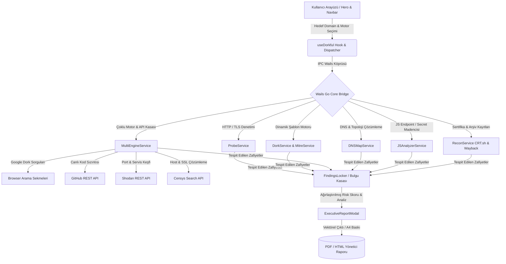
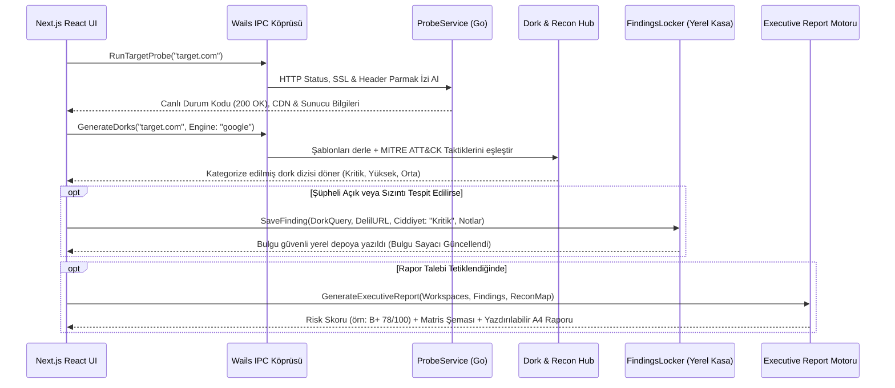

<div align="center">
  <h1>GALILEOFF DORKFUL - CYBER RECON & OSINT FRAMEWORK</h1>

  [](#)
  [](#)
  [](#)
  [](#)
  [](#)
  [](#)

<h3 align="center">galileoff-Dorkful</h3>
*galileoff ayrıcalıkları kapsamında geliştirilmiştir:)*
</div>

<br />

Galileoff Dorkful, siber güvenlik araştırmacıları, sızma testi (pentest) uzmanları ve tehdit istihbaratı analistleri için geliştirilmiş yeni nesil, masaüstü tabanlı bir **Otomatize Pasif İstihbarat (OSINT) ve Dijital Saldırı Yüzeyi Keşif Platformudur**. Doğrudan hedef sunucuyla temasa geçmeden (pasif keşif ilkesiyle), arama motorlarının ve küresel tehdit indekslerinin sakladığı hassas belgeleri, sızdırılmış veritabanlarını, unutulmuş `.env` yapılandırmalarını ve açık portları gün yüzüne çıkarır.

Wails v2 mimarisi üzerinde çalışan yüksek performanslı Go çekirdeği ile Next.js 16 / React 19 tabanlı modern cam (glassmorphism) arayüzünü birleştiren Dorkful; Google Dorking, GitHub sızıntı taraması, Shodan IoT/port denetimi, Censys host haritalama, DNS/Reverse IP topolojisi, JavaScript gizli secret avcısı (JS Miner) ve tek tıkla profesyonel **CTI Yönetici Raporu (A4 PDF)** çıktısını tek bir çatı altında sunar.

> [!CAUTION]
> **YASAL UYARI VE SORUMLULUK REDDİ BEYANI**
> 
> Bu proje, güvenlik araştırmacılarının, siber güvenlik öğrencilerinin, hata avcılarının (bug bounty hunters) ve yetkili sızma testi uzmanlarının, sistemlerdeki yanlış yapılandırmaları, veri sızıntılarını ve açıkta bırakılmış hassas varlıkları analiz etmeleri için **salt meşru denetim, zafiyet analizi ve eğitim amacıyla** hazırlanmıştır.
> 
> * Bu yazılımın hedef sistem sahiplerinin yazılı izni ve yasal onayı olmaksızın, veri hırsızlığı, yetkisiz erişim veya casusluk amacıyla kullanılması **kesin suretle yasa dışıdır**.
> * Arama motorları üzerinden elde edilen indekslenmiş veriler halka açık olsa dahi, tespit edilen sistemlere izinsiz giriş denemek kanunen suç teşkil eder.
> * Proje kodunun yasa dışı kullanımından doğacak her türlü hukuki, cezai ve idari yaptırımlardan bütünüyle **yazılımı çalıştıran veya yayan kullanıcı** sorumludur.
> * Geliştirici(ler), bu yazılımın kötü niyetli veya amacının dışındaki eylemlerde kullanılmasından ötürü hiçbir mesuliyet kabul etmez. Depoyu klonlayan kişi bu şartları kanunen peşinen kabul etmiş sayılır.

---

## 1. Sistem Mimarisi ve Asenkron Veri Akış Modeli

Dorkful, masaüstü işletim sistemi donanımı ile modern web render motoru arasında sıfır gecikmeli IPC (Inter-Process Communication) köprüsü kurar. Uygulama; Go tabanlı istihbarat servisleri, asenkron REST/DNS ağ iş parçacıkları, yerel JSON/SQLite depolama kasası ve Next.js reaktif state döngüsü olmak üzere 4 temel katmanda çalışır.

### 1.1 Aktif Sistem Akış Ağacı (Mermaid DAG)

Kullanıcının bir hedef alan adı girmesinden istihbarat raporunun derlenmesine kadar olan asenkron veri işleme rotası:



### 1.2 Hedef İstek ve Tepki Senaryosu (Sequence Diagram)

Kullanıcının tek bir hedef için başlattığı analiz zincirinin iç dinamikleri ve servisler arası etkileşim zaman çizelgesi:



---

## 2. Çekirdek Bileşen Kataloğu ve Kaynak Yönetimi

Yazılım mimarisi, modülerlik ve yüksek eşzamanlılık (concurrency) prensiplerine tam sadakat gösterecek şekilde Go backend paketleri ve React mikro-bileşenleri olarak ayrıştırılmıştır.

### Backend İstihbarat ve Servis Birimleri (Go)

İşletim sistemi düzeyinde ham ağ soketlerini yöneten, çok kanallı (goroutine) tarama yapan ve dış API'larla haberleşen çekirdek servislerdir.

| Dosya Dizini | Altyapı Desteği ve Mimari Amacı |
| :--- | :--- |
| **`dork_service.go`** | Yüzlerce önceden optimize edilmiş güvenlik şablonunu hedef alan adına uyarlar; `{target}` yer tutucularını dinamik biçimde çözer. |
| **`multi_engine_service.go`** | Google Dorking haricinde GitHub Leaks, Shodan ve Censys REST API bağlantılarını asenkron olarak yürüten çoklu motor yöneticisidir. |
| **`dns_map_service.go`** | Hedefin A, AAAA, MX, NS, CNAME ve TXT kayıtlarını çözer; Reverse IP sorgulamasıyla aynı sunucudaki ortak komşu siteleri haritalar. |
| **`js_analyzer_service.go`** | **JS Secret Miner:** Hedef uygulamanın JavaScript kaynak dosyalarını canlı indirir, regex motoruyla sızdırılmış AWS, Google API ve gizli endpointleri ayıklar. |
| **`recon_service.go`** | CRT.sh Sertifika Şeffaflığı (Certificate Transparency) loglarını ve Wayback Machine arşivini tarayarak unutulmuş alt alan adlarını çeker. |
| **`probe_service.go`** | Hedefin ayakta olup olmadığını (200, 301, 403 vb.), SSL geçerlilik süresini ve güvenlik başlıklarını (HSTS, CSP) milisaniyeler içinde denetler. |
| **`mitre_service.go`** | Üretilen her dork sorgusunu küresel MITRE ATT&CK bilgi tabanındaki kurumsal tekniklerle (T1552, T1190, T1083 vb.) ilişkilendirir. |
| **`finding_service.go`** | Tespit edilen zafiyetlerin, ekran kanıtlarının ve analist notlarının yerel veritabanında bütünlüğünü ve CRUD operasyonlarını sağlar. |
| **`settings_service.go`** | Shodan, Censys ve GitHub API anahtarlarını işletim sistemi düzeyinde şifreli ve izole bir kasada saklar. |
| **`workspace_service.go`** | Farklı müşteri hedefleri veya projeler için izole analiz çalışma alanları (Workspaces) oluşturup yönetir. |

### Frontend Arayüz ve Modüler Bileşen Mimarisi (Next.js / React 19)

Raycast, Linear ve Vercel tasarım dillerinden ilham alan, GPU hızlandırmalı modern arayüz bileşenleri:

| Dosya Dizini | Arayüz Katmanı ve Görev Mekaniği |
| :--- | :--- |
| **`useDorkful.js`** | Uygulamanın beynidir. Tüm Wails IPC bağlantılarını, reaktif durumları, bildirimleri ve global klavye kısayollarını (`?`, `F1`, `Enter`, `Esc`) yönetir. |
| **`Hero.jsx`** | Spotlight tarzı dinamik arama çubuğu, motor seçici açılır menüsü, hızlı komut çubuğu ve yeni başlayanlar için onboarding rozetini barındırır. |
| **`Navbar.jsx`** | Sayfa aşağı kaydırıldığında devreye giren sabit cam (sticky glass) menüdür. Kompakt arama, kaydırılabilir kategori filtreleri ve aksiyon butonlarını içerir. |
| **`TutorialModal.jsx`** | **Görsel Kullanım Kılavuzu:** Sıfırdan başlayanlar için 5 adımlı interaktif görsel UI simülasyon turu ve 6 derinlemesine rehber konusunu barındıran bilgi bankasıdır. |
| **`ReconHubModal.jsx`** | DNS Haritası, CRT.sh, Wayback, Shodan, Censys, GitHub Leaks ve JS Miner araçlarını tek ekranda toplayan konsolide keşif merkezidir. |
| **`FindingsLockerModal.jsx`** | Bayraklanan zafiyetlerin risk derecelerine göre filtrelendiği, delil URL'lerinin ve analist notlarının depolandığı kanıt kasasıdır. |
| **`ExecutiveReportModal.jsx`** | Otomatik risk skoru (örn: B+ 78/100) hesaplayan, MITRE zafiyet dağılım grafikleri çizen ve A4 PDF baskıya hazır profesyonel CTI raporu modülüdür. |
| **`TargetProbeCard.jsx`** | Hedefin HTTP durumunu, yanıt süresini, kullanılan sunucu yazılımını ve algılanan teknolojileri gösteren canlı telemetri kartıdır. |
| **`ModalShell.jsx`** | Tüm pencerelerde görsel ve etkileşim tutarlılığı sağlayan, ESC ile kapanabilen ortak cam (Glassmorphism) modal kabuğudur. |

---

## 3. Modüler İstihbarat & Keşif Matrisi

Dorkful'un bünyesinde barındırdığı gelişmiş analiz yetenekleri ve operasyonel çıktı tablosu:

| İstihbarat Modülü | Analiz Alanı ve Taktiksel Çıktı | Gereksinim / İzin Durumu |
| :--- | :--- | :--- |
| **Google Dork Engine** | Hedef sunucuya dokunmadan `.env`, `.sql`, `.git`, phpinfo, admin panelleri ve hassas belgeleri arama motoru indeksinden tespit eder. | *Gereksinim Yok (Pasif)* |
| **GitHub Secret Miner** | Canlı GitHub kod araması yaparak geliştiricilerin açık depolara kazara yüklediği AWS, Slack, Stripe ve veritabanı tokenlarını süzgeçten geçirir. | *GitHub Personal Access Token* |
| **Shodan IoT / Port Scanner** | Hedef alan adının bağlı olduğu IP bloklarındaki açık portları (RDP, SSH, DB, Telnet), çalışan servis versiyonlarını ve CVE açıklarını çeker. | *Shodan API Anahtarı* |
| **Censys Host Haritası** | Hedefin SSL/TLS sertifikalarını analiz ederek Cloudflare/CDN arkasına gizlenmiş gerçek kaynak sunucu IP adreslerini ve sanal hostları deşifre eder. | *Censys API ID & Secret* |
| **DNS & Reverse IP Haritası** | Hedefin tüm DNS kayıtlarını (A, MX, NS, CNAME, TXT) şematik ağacında listeler; aynı sunucuyu paylaşan yan hedefleri keşfeder. | *Gereksinim Yok* |
| **JS Secret & Endpoint Miner** | Hedef web sayfasının kaynak kodundaki tüm `.js` scriptlerini indirip regex ile ayrıştırarak gizli API uçlarını ve tokenları ayıklar. | *İnternet Erişimi* |
| **CRT.sh Sertifika Şeffaflığı** | Yıllar boyu alınmış tüm SSL sertifikalarını Certificate Transparency günlüklerinden tarayarak gizli geliştirme/test alt alan adlarını (subdomains) bulur. | *Gereksinim Yok* |
| **Wayback Machine Arşivi** | Hedef sitenin geçmiş yıllardaki indekslenmiş URL kalıntılarını tarayarak artık menüde olmayan eski parametre ve dosyaları kurtarır. | *Gereksinim Yok* |
| **Bulgu Defteri (Findings)** | Kritik bulunan sonuçları tek tıkla delil URL'si, analiz notu ve önem derecesiyle yerel veritabanında arşivler. | *Yerel Depolama* |
| **CTI Yönetici Raporu** | Elde edilen tüm verileri uluslararası kurumsal standartlara uygun A4 formatında PDF ve HTML siber pentest raporuna dönüştürür. | *Yerel Derleme* |
| **Görsel Kullanım Kılavuzu** | Uygulamayı hiç bilmeyenler için UI mockup'ları ile desteklenmiş 5 adımlı görsel başlangıç turu ve derinlemesine SSS rehberi sunar. | *Uygulama İçi (F1 / ?)* |

---

## 4. Kaynak Kod Derleme ve Kurulum Protokolü

Projeyi yerel laboratuvar ortamınızda çalıştırmak veya masaüstü çalıştırılabilir dosyası (Binary) olarak derlemek için aşağıdaki adımları izleyin.

### 4.1 Ön Gereksinimler
* **Go (Golang):** `v1.21` veya üzeri ([go.dev](https://go.dev/dl/))
* **Node.js:** `v18.0` veya üzeri ([nodejs.org](https://nodejs.org/))
* **Wails CLI:** Wails v2 geliştirici aracı
  ```bash
  go install github.com/wailsapp/wails/v2/cmd/wails@latest
  ```

### 4.2 Kurulum ve Bağımlılıkların Yüklenmesi
1. Repoyu bilgisayarınıza klonlayın:
   ```bash
   git clone https://github.com/galile0ff/galileoff-Dorkful.git
   cd galileoff-Dorkful
   ```

2. Frontend paketlerini yükleyin:
   ```bash
   cd frontend
   npm install
   cd ..
   ```

3. Geliştirme (Canlı Yenileme / Dev) modunda başlatın:
   ```bash
   wails dev
   ```
   *Uygulama penceresi otomatik olarak açılacak ve Go/React kodlarında yapılan değişiklikler anında ekrana yansıyacaktır.*

### 4.3 Prodüksiyon Masaüstü Uygulaması (Build) Derleme
İşletim sisteminize özel optimize edilmiş, bağımsız çalışabilen (.exe / binary) kurulum dosyasını üretmek için:
```bash
wails build
```
Derlenen çalıştırılabilir dosya `build/bin/` dizini altında hazır olacaktır.

---

## 5. Bilinen İhtiyaçlar ve Geliştirme Yol Haritası (Roadmap)

Açık kaynak destekçilerinin, tehdit istihbaratı analistlerinin ve siber güvenlik araştırmacılarının bilgisine sunulan; sistemin karakalem taslağından kurumsal bir CTI platformuna evrilme sürecinde planlanan geliştirmeler aşağıda kategorize edilmiştir.

> **galileoff. Notu:** Bu listede yer alan zafiyetler ve hata kayıtları benim tarafımdan kademeli olarak çözülmekte olup, pürüzleri giderilen her bir madde güncellemeler eşliğinde bu listeden kaldırılacaktır.

### Geliştirme Bekleyen İhtiyaçlar & Çözüm Mimarisi Matrisi

| Bileşen Kategorisi | Karşılaşılan Durum ve İhtiyaç Anatomisi | Uygulanacak Çözüm Mimarisi |
| :--- | :--- | :--- |
| **Arama Motoru** | **Google CAPTCHA & Sıra Dışı Trafik Sınırı:** Kullanıcı peş peşe çok sayıda dork sekmesi açtığında Google IP adresini geçici olarak robot doğrulamasına sokabilmektedir. | Arayüze isteğe bağlı Tor SOCKS5 ve HTTP Proxy rotasyon desteği eklenecek; dorklar arası otomatik bekleme süresi (Jitter/Delay) yapılandırılabilecektir. |
| **Çoklu Motor & API** | **Sayfalama (Pagination) ve Derin Sonuç Eksikliği:** Shodan ve Censys entegrasyonu şu an için ilk sayfa sonuçlarını çekmektedir; büyük hedef ağlarda binlerce IP tek ekrana sığmamaktadır. | Shodan ve Censys modüllerine sayfalama (Cursor-based pagination) ve hedef port dağılımını gösteren interaktif pasta grafik analizi entegre edilecektir. |
| **JS Secret Miner** | **Dinamik Single-Page (SPA) Kod Analizi:** Bazı hedeflerde JavaScript dosyaları harici web-pack chunkları halinde dinamik yüklendiğinden statik regex tüm gizli yolları yakalayamayabilmektedir. | Headless Chromium motoru arka planda koşturularak sayfadaki tüm dinamik network isteklerini dinleyen bir DOM dinleyicisi eklenecektir. |
| **Alt Alan Taraması** | **Pasif Kayıtların Ötesinde Aktif Keşif:** CRT.sh ve Wayback Machine yalnızca geçmişte kaydedilmiş alt alanları bulur; yeni açılan gizli sunucular yakalanamayabilir. | Dahili, çok kanallı (Go goroutines) hafif bir DNS Brute-Force kelime listesi (Wordlist) fırlatıcısı sisteme opsiyonel olarak dahil edilecektir. |
| **Raporlama Motoru** | **Şablon ve Tema Özelleştirme:** Mevcut Yönetici Raporu katı bir CTI formatına sahiptir; kullanıcılar kendi firma logolarını veya özel renk paletlerini ekleyememektedir. | Ayarlar menüsüne kurum logosu yükleme, özel başlık ekleme ve Word / Markdown formatında dışa aktarma yeteneği kodlanacaktır. |
| **Çalışma Alanı (Workspace)** | **Proje Senkronizasyonu & İçe Aktarma:** Oluşturulan çalışma alanları şu anda yalnızca yerel disktedir; ekip içi paylaşım için taşınabilir format desteği eksiktir. | Tüm çalışma alanını, bulguları ve notları şifreli tek bir `.dorkful` arşiv paketi olarak dışa/içe aktarma fonksiyonu getirilecektir. |

---

## 6. Destek

Bu proje açık kaynaklıdır ve topluluk desteğiyle geliştirilebilir. Eğer işinize yaradıysa:

<div align="center">
<a href="https://www.buymeacoffee.com/galileoff" target="_blank">

</a>
</div>

## 7. Katkıda Bulunma

1. Projeyi Fork'layın
2. Yeni bir Özellik Dalı oluşturun (`git checkout -b feature/YeniOzellik`)
3. Değişikliklerinizi commit'leyin (`git commit -m 'feat: Yeni istihbarat motoru eklendi'`)
4. Dalınıza push'layın (`git push origin feature/YeniOzellik`)
5. Bir Pull Request açın

## 8. Star History

<a href="https://www.star-history.com/#galile0ff/galileoff-Dorkful&type=date&legend=top-left">
 <picture>
   <source media="(prefers-color-scheme: dark)" srcset="https://api.star-history.com/svg?repos=galile0ff/galileoff-Dorkful&type=date&theme=dark&legend=top-left" />
   <source media="(prefers-color-scheme: light)" srcset="https://api.star-history.com/svg?repos=galile0ff/galileoff-Dorkful&type=date&theme=dark&legend=top-left" />
   
 </picture>
</a>

## 9. Lisans

Bu proje **MIT Lisansı** ile lisanslanmıştır. Detaylar için `LICENSE` dosyasına bakınız.

---

<div align="center">
Developed with 💜 by <a href="https://github.com/galile0ff">galileoff</a>
</div>
